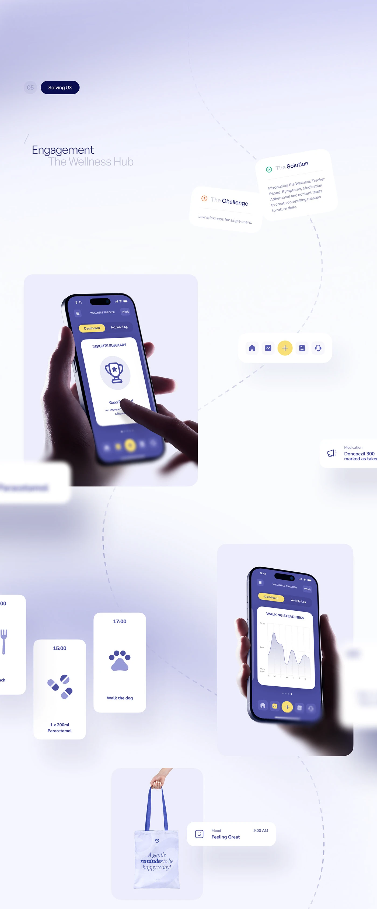

# Wellness hub engagement story with floating reminder cards on a lilac field and dashed path

**Discipline:** app ·  · **Design style:** Glassmorphism
**Tags:** wellness, case-study, lilac, indigo, floating-cards, dashed-path, reminders, phones-in-hand

## What it is
A long pale lilac board with a 'Solving UX' pill, a title, challenge and solution notes tilted at angles, two hand-held indigo phones in rounded squares, an icon nav pill, blurred reminder cards (medication, walk the dog, meal), a tote bag with a quote and a mood card, all linked by a dashed winding path.

## What it means
Soft and human; scattered blurry cards convey a day of gentle prompts.

## Techniques
- Scatter UI cards and photos along a dashed path.
- Blur cards at the edges to imply depth.
- Tilt notes slightly like pinned papers.
- Use one indigo with a yellow accent.

## Best for
- Health and habit-app case studies
- Engagement and retention stories
- Soft-pastel UX boards

## Vocabulary
- **Floating reminder** — A small card representing a notification.
- **Path narrative** — Items connected by a dashed line telling a story.
- **Depth blur** — Blurring outer elements to imply distance.
- **Tilted note** — A note card rotated for casualness.
