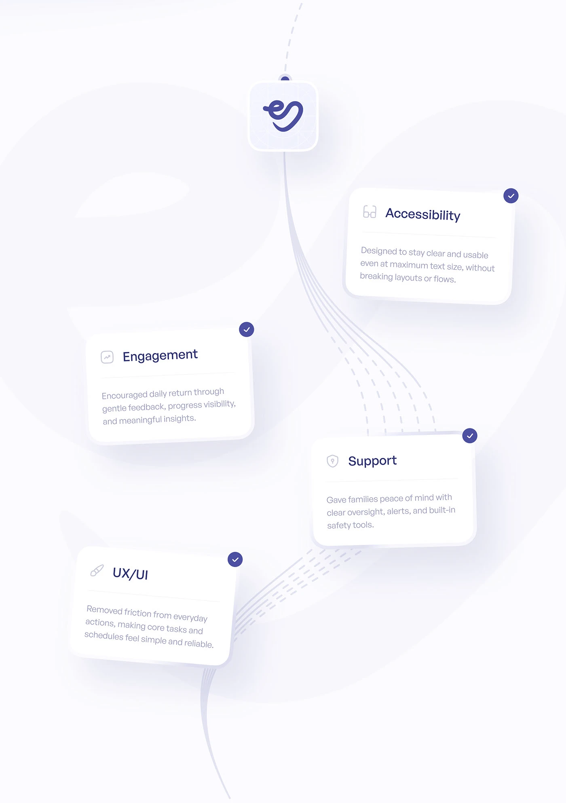

# Benefit Cards on a Curved Path from the App Icon

**Discipline:** app · **Design type:** Process slide
**Tags:** benefits, cards, curved-path, dashed-line, checkmarks, app-icon, pale

## What it is
A pale page with an app icon at the top from which a dashed and solid curved path descends past four tilted white cards (Accessibility, Engagement, Support, UX/UI), each with an icon, a short description and an indigo check badge.

## What it means
Cards hanging along a flowing path feel like a journey of outcomes, and check badges confirm each goal.

## Techniques
- Flowing line bundle from an icon down the page
- Tilted cards alternating left and right
- Indigo check badge on each card corner
- Faint giant logo shape as a background
- Soft shadows for a floating feel

## Best for
- Outcome and benefit slides
- Case-study results summaries
- Path-based storytelling

## Vocabulary
- **Path bundle** — Several parallel lines curving together as a route.
- **Check badge** — A small circle with a tick marking completion.
- **Floating card** — A card with a soft shadow that appears to hover.
