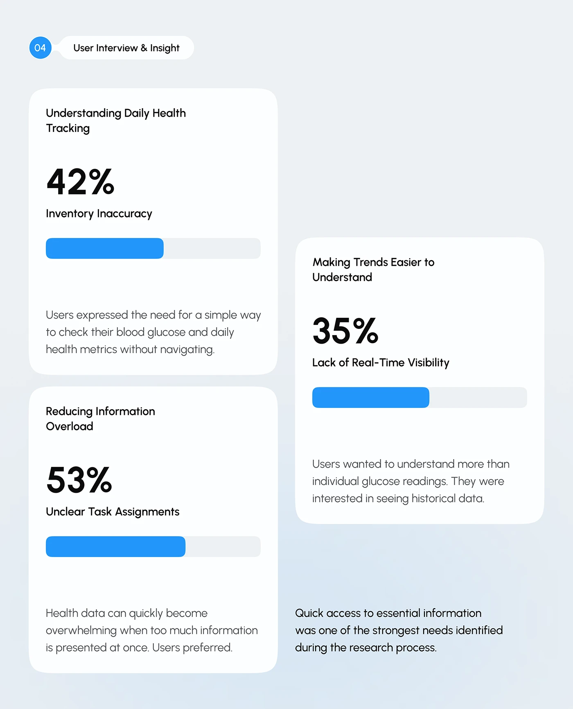

# Huge Percentages with Blue Progress Bars

**Discipline:** app ·  · **Design style:** Minimalist
**Tags:** research, percentages, progress-bars, white-cards, blue, staggered, interview

## What it is
A pale slide with a numbered User Interview & Insight pill and three staggered white cards, each with a topic, a very large percentage, a label, a blue progress bar and a sentence, and a closing statement bottom right.

## What it means
Enormous numerals and simple bars make research findings instantly readable.

## Techniques
- Giant bold percentages as the hero
- Chunky blue progress bars
- Staggered cards in two columns
- Small descriptive sentence at the card base
- Closing statement outside the cards

## Best for
- User interview summaries
- Research finding slides
- Stat-led case-study slides

## Vocabulary
- **Hero percentage** — A very large number that is the focal point of a card.
- **Progress bar** — A bar showing a proportion filled.
- **Stagger** — Cards offset vertically to avoid a rigid grid.
