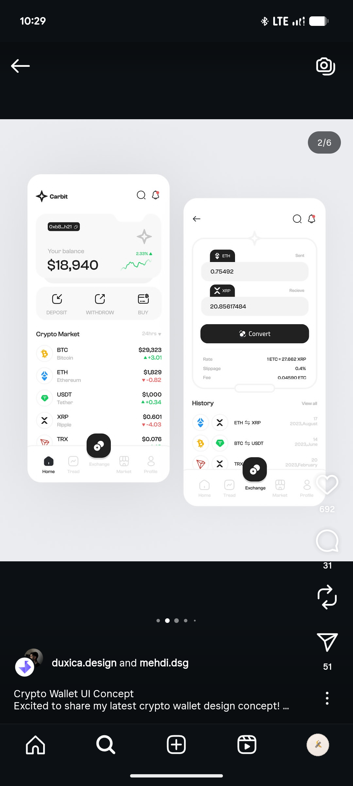

# White Crypto Wallet with Floating Exchange Button

**Discipline:** app ·  · **Design style:** Dark & Neon
**Tags:** crypto, wallet, white, black, convert, floating-button, market-list

## What it is
Two white phones on light grey: a wallet home with a balance card and sparkline, Deposit, Withdraw and Buy actions, and a crypto market list with green and red changes; and a Convert screen with sent and receive fields, a black Convert button, rate details and a history list, both with a raised black exchange button in the tab bar.

## What it means
Clean white cards with black actions and semantic green and red make market data easy to scan.

## Techniques
- Raised black button in the tab bar for the main action
- Small sparkline in the balance card
- Green and red price changes
- Two-field converter with a black CTA
- Coin icons in their brand colours as the only colour

## Best for
- Crypto wallet and exchange apps
- Light minimal fintech UI
- Convert and swap screens

## Vocabulary
- **Raised tab button** — A tab bar item lifted above the bar as the primary action.
- **Sparkline** — A tiny line chart shown beside a figure.
- **Converter** — A two-field form for exchanging one asset for another.
