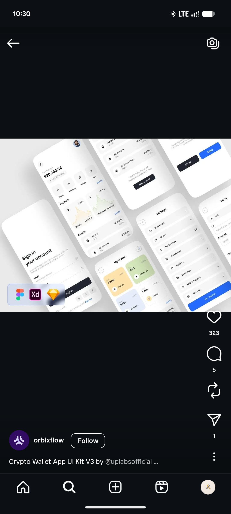

# Tilted Crypto Wallet UI Kit Field

**Discipline:** app · **Design type:** Fintech app screens
**Tags:** ui-kit, crypto, white, blue, tilted, sign-in, settings, figma

## What it is
A field of white wallet screens all rotated at the same angle over grey: sign in, home with balance and sparkline cards, token list, share and copy address, settings list with a blue Log Out button and a card grid for my wallet in yellow, green and blue, with Figma, XD and Sketch badges.

## What it means
Tilting the entire grid makes a kit feel dynamic, and small tint colours give each coin a card identity.

## Techniques
- Whole screen grid rotated at one angle
- White screens on light grey with soft shadows
- Blue as the single action colour
- Pastel tinted cards per coin
- Tool badges to state file formats

## Best for
- UI kit marketplace previews
- Crypto wallet flows
- Rotated screen-grid compositions

## Vocabulary
- **Rotated grid** — A whole layout of screens turned by the same angle.
- **Kit badge** — An icon showing which design tools a kit supports.
- **Tinted card** — A card given a pale colour to identify its content.
