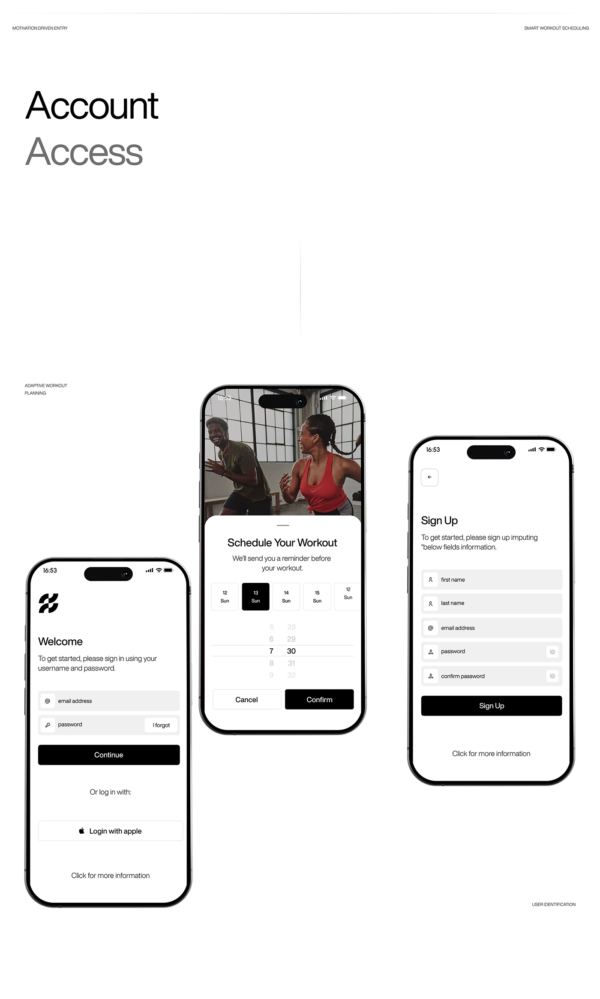

# Account access flow in black and white: login, workout scheduler and sign-up

**Discipline:** app ·  · **Design style:** Dark & Neon
**Tags:** onboarding, login, signup, white, black-buttons, date-picker, photo-header, case-study

## What it is
A white board titled 'Account Access' with three staggered phones: a welcome login with grey filled inputs and black Continue, a scheduler with a photo of two people training and a date picker sheet, and a sign-up form with icon fields.

## What it means
Clean, direct and confident; black-on-white buttons and filled fields make forms feel effortless.

## Techniques
- Use grey filled inputs with small left icons.
- Keep one wide black primary button per screen.
- Introduce a photo header above a bottom sheet for a motivating moment.
- Present a two-tone title with the second word dimmed.

## Best for
- Fitness and lifestyle apps
- Form-heavy onboarding
- Minimal monochrome UI

## Vocabulary
- **Filled input** — A field with a soft grey background.
- **Wheel picker** — A scrolling selector for dates or numbers.
- **Photo header sheet** — A photo above a rounded white bottom sheet.
- **Primary black button** — A full-width black action button.
