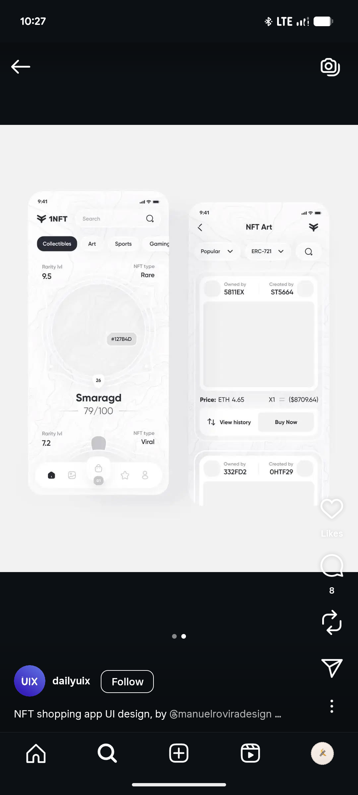

# White-on-White NFT Shopping Screens

**Discipline:** app ·  · **Design style:** Minimalist
**Tags:** nft, white, neumorphic, monochrome, topographic, rarity, tab-bar

## What it is
Two nearly all-white phone screens with faint topographic line texture: a collectibles home with category pills, rarity levels and a circular artwork slot above a name and score, and an NFT Art list with owner and creator chips, price, View history and Buy Now.

## What it means
Tone-on-tone white gives a soft, tactile calm, and tiny black details do the work of hierarchy.

## Techniques
- White on white with soft raised shadows
- Black pill as the only strong selected state
- Faint topographic texture as background
- Rarity stats placed at the card corners
- Circular artwork slot as the focal point

## Best for
- Minimal collectible and marketplace apps
- Neumorphic UI studies
- Tone-on-tone presentations

## Vocabulary
- **Tone-on-tone** — Using near-identical values so structure comes from shadow and contrast.
- **Rarity level** — A score showing how scarce a collectible is.
- **Topographic texture** — Contour-map lines used as a subtle background.
