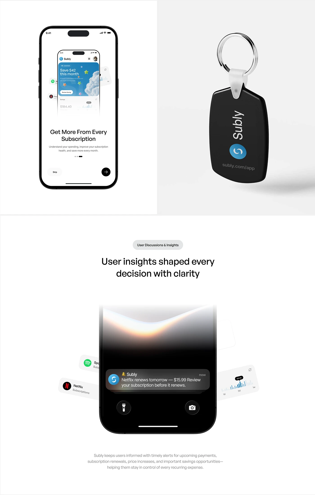

# Subscription App Onboarding, Keyring and Lock-Screen Alert

**Discipline:** app · **Design type:** Brand application mockups
**Tags:** onboarding, keyring, lock-screen, notification, white, black, merch

## What it is
A white board with a phone-in-phone onboarding screen, a black rubber keyring with the app logo and URL, a heading about user insights and a dark lock screen with a warm glow and a renewal notification flanked by floating subscription cards.

## What it means
Showing a physical keyring and a real lock-screen notification proves the brand and product work outside the app.

## Techniques
- Phone inside a phone as a nested preview
- Black keyring merch shown on pale grey
- Lock-screen glow with a frosted notification
- Floating cards angled beside the phone
- Simple centred headline and caption

## Best for
- Subscription app brand and product boards
- Notification design showcases
- Merch and app touchpoints

## Vocabulary
- **Nested mockup** — A device shown inside another device's screen.
- **Lock-screen alert** — A notification displayed on a phone's lock screen.
- **Merch touchpoint** — A promotional object carrying the brand.
