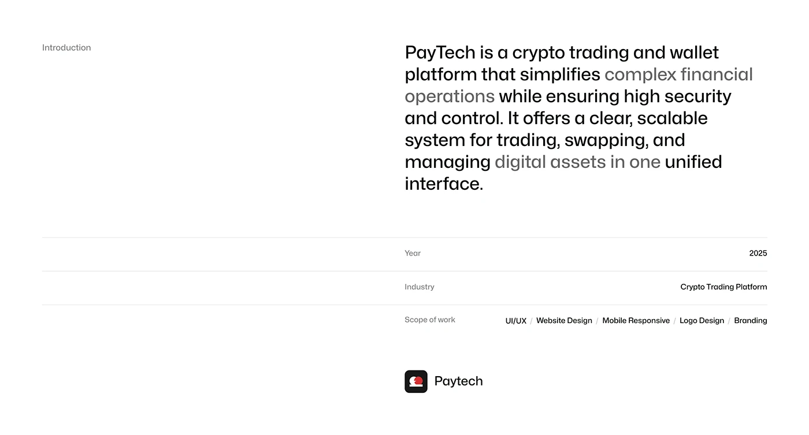

# White Project Introduction with Metadata Rows

**Discipline:** app ·  · **Design style:** Minimalist
**Tags:** introduction, white, text, metadata, rules, minimal, tone-shift

## What it is
A white slide with a small 'Introduction' label at left and a large paragraph on the right whose middle phrases fade to grey, followed by ruled rows for Year, Industry and Scope of work, and a small app icon and name.

## What it means
The grey phrases and hairline rows give a calm editorial rhythm, and the strong asymmetry keeps a text slide interesting.

## Techniques
- Asymmetric layout with the label far left and text on the right
- Mid-paragraph shift from black to grey to emphasise
- Hairline rows for key/value metadata
- Slash-separated scope list
- Tiny logo lockup as the sign-off

## Best for
- Case-study introductions
- Project summaries
- Editorial-style portfolio slides

## Vocabulary
- **Tone shift** — Changing text between dark and light greys to guide reading.
- **Ruled row** — A row separated by hairlines showing one label and value.
- **Scope list** — A slash-separated list of the services provided.
