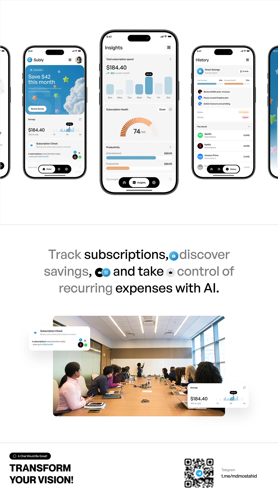

# Subscription App Screens and Closing CTA

**Discipline:** app · **Design type:** Case study closing slide
**Tags:** subscriptions, white, phones, statement, photo, qr, closing

## What it is
A tall white board: a row of five phones (savings, insights gauge, history), a large light statement with inline icons, an office meeting photo with two floating UI cards, and a closing 'TRANSFORM YOUR VISION!' with a QR code.

## What it means
Inline icons in a statement and UI cards over a real photo tie the product to real life, and the closing line invites contact.

## Techniques
- Row of phones with the centre one larger
- Inline icon chips within a large sentence
- Grey and black phrases inside one statement
- UI cards overlapping a candid photo
- Heavy black closing line with a QR code

## Best for
- Case-study finales
- Fintech subscription products
- Portfolio calls to action

## Vocabulary
- **Inline chip** — A small icon placed within a line of text.
- **Hero phone** — The larger centre device in a row.
- **QR sign-off** — A QR code offering contact at the end of a case study.
