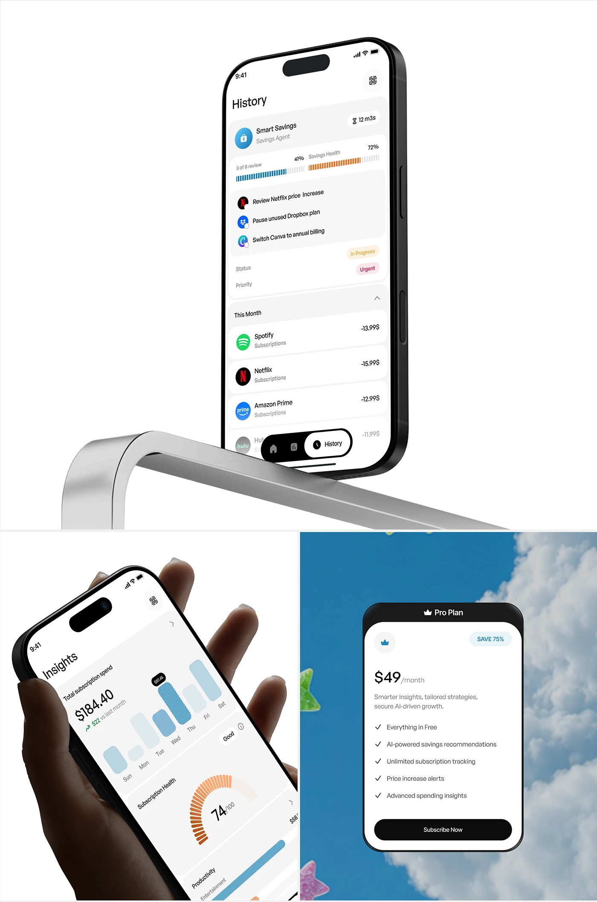

# Subscription History, Insights and Pro Plan Board

**Discipline:** app ·  · **Design style:** 3D & Surreal
**Tags:** subscriptions, white, chrome, sky, pricing, hand, stars

## What it is
A white board with a tilted history screen resting on a chrome bar, a hand-held insights screen with an orange gauge, and a sky photo tile with a Pro Plan pricing sheet and a gummy star.

## What it means
A chrome prop and a sky photo add surprise to clean white screens, and pricing is presented as a friendly card.

## Techniques
- Chrome bar as a prop for the phone
- Sky and cloud photo behind the pricing card
- Segmented orange gauge as signature graphic
- 3D gummy stars as playful accents
- Black header on the pricing card

## Best for
- Subscription app showcases
- Pricing screen presentation
- Clean tilted device compositions

## Vocabulary
- **Chrome prop** — A shiny metal object used as a scene element.
- **Pricing sheet** — A card listing a plan's price and features.
- **Tilted device** — A device rotated to add dynamism.
