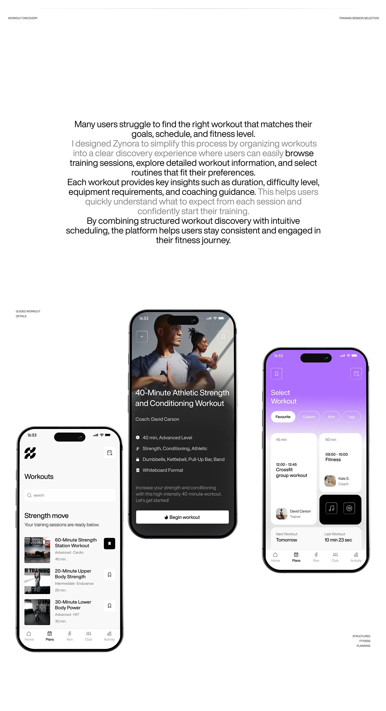

# White slide with a centred dimmed-and-bold paragraph and three phones: workouts list, dark workout detail and violet schedule

**Discipline:** app ·  · **Design style:** Dark & Neon
**Tags:** fitness, white, black, violet, case-study, paragraph, phones, workouts

## What it is
A white board with tiny corner labels, a centred paragraph where some sentences are grey, and three phones: a white Workouts list with thumbnail rows and a search, a dark workout detail with a photo and a white Begin workout button, and a violet gradient Select Workout with pills and time cards.

## What it means
Clear and structured; three moods (light, dark, violet) show range in one flow.

## Techniques
- Dim sentences in a centred paragraph.
- Use white, dark and violet screens together.
- Stagger phones on a white board.
- Keep tiny corner labels.

## Best for
- Fitness app case studies
- Discovery and scheduling flows
- Minimal white boards

## Vocabulary
- **Dimmed paragraph** — A paragraph with some sentences in grey.
- **Mood range** — Screens shown in light, dark and colour.
- **Workout row** — A list item with thumbnail and metadata.
- **Bookmark button** — A save icon on a list item.
