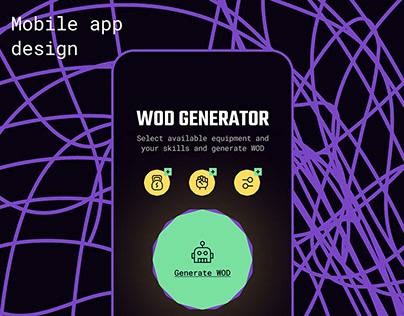

# WOD generator with big green button and violet scribble on black

**Discipline:** app ·  · **Design style:** Dark & Neon
**Tags:** fitness, dark, violet-scribble, mint-green, yellow-icons, big-button, case-study-cover

## What it is
A black case-study cover with the words 'Mobile app design' and a phone screen titled 'WOD GENERATOR', three yellow round icons for equipment and skills, and a big mint-green circular 'Generate WOD' button with a robot icon. A tangled violet line scribble fills the background.

## What it means
Playful, gym-cool and simple; one giant button says what the app does.

## Techniques
- Make the one primary action a giant circular button.
- Use a hand-drawn tangled line as a background pattern.
- Use yellow round icons as secondary selectors.
- Keep contrast high on a black canvas.

## Best for
- Single-purpose utility apps
- Fitness and gamified tools
- Portfolio covers with strong contrast

## Vocabulary
- **Hero button** — An oversized primary control that is the main action.
- **Scribble pattern** — A loose tangled line used as a background.
- **Selector icon** — A round icon used for choosing options.
- **Single-action screen** — A screen built around one task.
