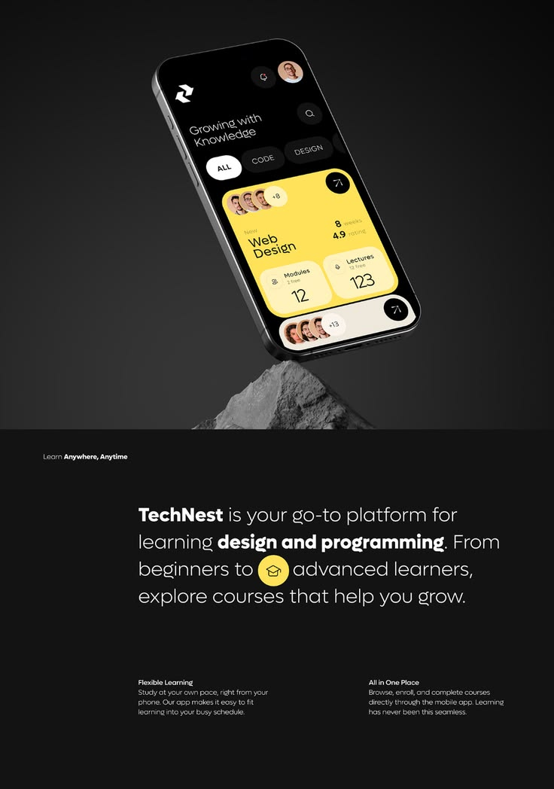

# Course App Phone Balanced on Rock

**Discipline:** app ·  · **Design style:** 3D & Surreal
**Tags:** education, yellow, black, rock, balance, dark, learning

## What it is
A tall dark poster with a phone showing a black learning app with a big yellow course card balanced on a grey rock, and a text section below introducing the platform with a yellow graduation-cap icon inline.

## What it means
Balancing on rock signals stability and craft, and yellow on black reads as smart and energetic.

## Techniques
- Phone balanced on a rough stone for contrast with sleek UI
- Yellow card as the only warm colour on black
- Inline icon inside a paragraph as a visual break
- Gradient from dark grey to black for depth
- Two-column small print below the hero

## Best for
- Education and course platforms
- Tall case-study heroes
- Dark premium tech brands

## Vocabulary
- **Inline icon** — A small icon placed within a line of text.
- **Stone pedestal** — A rock used as a display base.
- **Warm accent on dark** — A single warm hue set against a black scheme.
