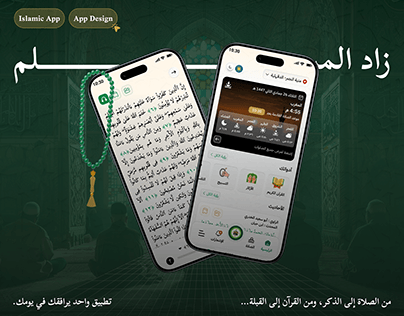

# Zad Al-Muslim Islamic app cover in deep green with prayer beads and two phones

**Discipline:** app · **Design type:** Device mockup scene · **Design style:** Photographic & Cinematic
**Tags:** islamic, arabic, green, prayer-times, quran, case-study-cover

## What it is
A dark green cover over a faded mosque interior with a large white Arabic calligraphic title, green prayer beads with a gold tassel, two phones (Quran page, home with prayer times and features), and pill tags 'Islamic App' and 'App Design'.

## What it means
Reverent and calm; deep green and the tasbih set a spiritual tone.

## Techniques
- Use a culturally meaningful object as a prop.
- Fade an architectural photo into the brand colour.
- Let a large calligraphic title span the top.

## Best for
- Religious apps
- Arabic apps
- Lifestyle app covers

## Vocabulary
- **Tasbih** — Muslim prayer beads.
- **Calligraphic title** — A heading written in decorative script.
