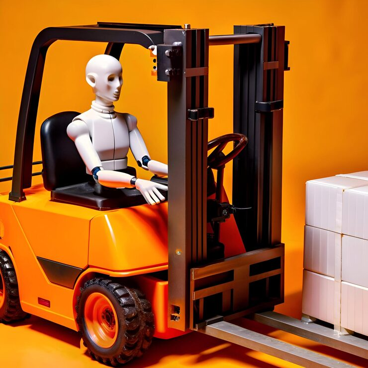

# 3D-rendered robot driving an orange forklift

**Discipline:** branding · **Design type:** Brand application mockups · **Design style:** 3D & Surreal
**Tags:** 3d render, robot, forklift, surreal, product illustration, orange

## What it is
A stylized 3D illustration of a humanoid robot operator driving a toy-like orange forklift against a flat orange backdrop.

## What it means
Placing a friendly robot in a mundane industrial role reframes automation as approachable rather than threatening, useful for logistics or AI-adjacent brand storytelling.

## Techniques
- render a whimsical subject in glossy, toylike 3D to soften an otherwise industrial theme
- match the backdrop color to the hero object's color family for a seamless studio look
- use a matte/glossy material contrast between robot and vehicle to separate the two subjects visually

## Best for
- logistics or robotics brand campaigns
- AI/automation marketing heroes
- playful B2B illustration sets

## Vocabulary
- **hero shot** — a prominent, centered product or subject image meant to be the focal point of a composition
