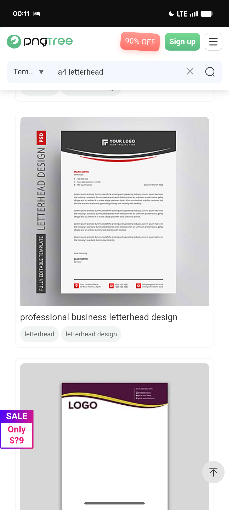

# Curved-Header A4 Letterhead Templates

**Discipline:** branding ·  · **Design style:** Corporate & Clean-Tech
**Tags:** letterhead, stationery, template, curve, red, purple, gold, print

## What it is
A stock-template search screen showing two A4 letterheads on grey: a white sheet with a black curved header holding a logo and a red curved line, contact details, body text, signature and a three-column footer with red icons, and a second sheet with a plum header and a gold wave line.

## What it means
A single curved header band with a contrasting accent line gives stationery a formal yet dynamic look and a clear place for the logo.

## Techniques
- Curved header band holding the logo
- Thin accent line following the curve
- Contact details grouped in a three-column footer
- Generous white body space
- Sheet shown on a grey ground with a soft shadow

## Best for
- Business stationery and letterheads
- Corporate identity systems
- Template design references

## Vocabulary
- **Letterhead** — Stationery with a branded header and footer.
- **Header band** — A coloured strip across the top of a page.
- **Accent line** — A thin coloured line adding emphasis to a shape.
