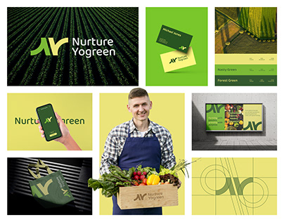

# Green and yellow farm identity in a modular grid of applications

**Discipline:** branding ·  · **Design style:** Geometric & Bauhaus
**Tags:** agriculture, green, yellow, monogram, brand-grid, business-cards, packaging, billboard

## What it is
A brand board where tiles show a monogram 'NY' with wordmark on dark crops, business cards on lime, a colour chart, an app on a phone in a hand, a smiling farmer with a vegetable crate, a tote bag, a billboard and a construction-grid diagram of the mark.

## What it means
Fresh, wholesome and trustworthy; the green-yellow palette feels like leaves and sunshine.

## Techniques
- Build a modular grid of tiles with different applications.
- Use aerial crop rows as a texture for the logo tile.
- Include a construction diagram to show the logo geometry.
- Pair a large lifestyle photo with brand colour bands.

## Best for
- Agriculture, food and eco brands
- Identity presentations
- Startups needing many touchpoints

## Vocabulary
- **Brand grid** — A layout of tiles showing many brand applications.
- **Construction diagram** — A drawing showing circles and lines used to build a logo.
- **Monogram lockup** — Initials combined with a wordmark.
- **Aerial texture** — A top-down photo used as pattern.
