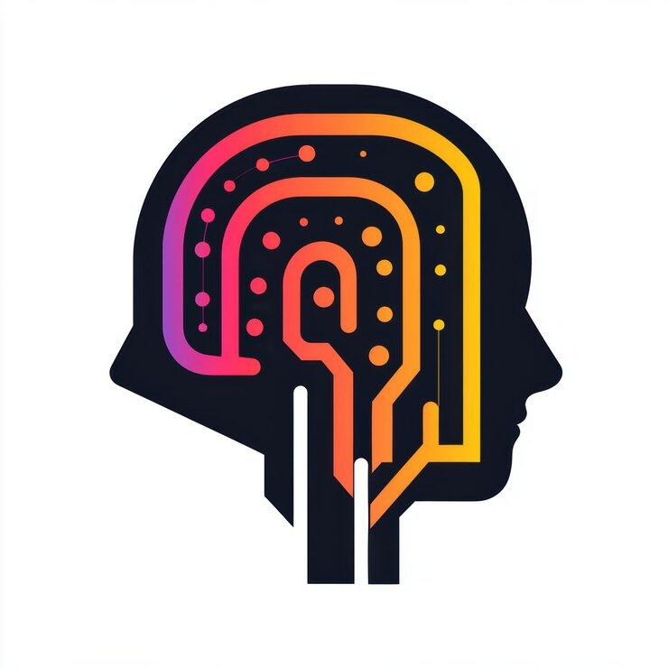

# AI brand mark: a black head silhouette filled with a pink-to-yellow gradient circuit maze

**Discipline:** branding · **Design type:** Logo with symbol · **Design style:** Geometric & Bauhaus
**Tags:** logo, ai, silhouette, gradient, circuit, tech

## What it is
A minimalist logo of a black human head in profile, with a winding circuit-board-style line in a pink-orange-yellow gradient running through the brain area, dotted with small circles like nodes, on a white background.

## What it means
Smart and approachable; a warm gradient circuit inside a human silhouette humanises artificial intelligence rather than making it feel cold.

## Techniques
- Fill a silhouette's interior with a symbolic pattern instead of a solid colour.
- Use a warm gradient to soften a technical circuit motif.
- Dot the circuit line with small nodes for a data feel.

## Best for
- AI and machine learning brands
- Tech startup logos
- Neuroscience or cognitive products

## Vocabulary
- **Silhouette fill** — Using the inside of an outline shape to hold a secondary pattern.
- **Circuit motif** — A winding line pattern resembling electronic pathways.
