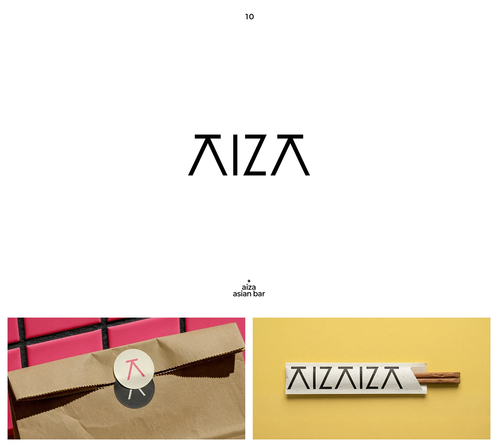

# Line-built AIZA wordmark with pink sticker on a kraft bag and chopstick sleeve

**Discipline:** branding ·  · **Design style:** Playful & Illustrated
**Tags:** wordmark, monoline, angular, asian-bar, packaging, kraft, sticker, yellow, pink

## What it is
A white slide with a black wordmark 'AIZA' whose As are open triangles without crossbars, then two photos: a kraft paper bag with a cream round sticker bearing a pink A on a hot-pink tile background, and a chopstick sleeve printed with the repeated wordmark on yellow.

## What it means
Precise and playful; open As suggest chopsticks or roof shapes and make a light logo distinctive.

## Techniques
- Drop crossbars from the A to create an open, architectural letter.
- Use a single letter as the sticker mark.
- Photograph packaging on bright flat colours.
- Repeat the wordmark as a pattern on sleeves.

## Best for
- Restaurants and takeaway brands
- Wordmarks with a signature letter
- Small packaging items

## Vocabulary
- **Open A** — An A drawn without a crossbar.
- **Sticker seal** — A round sticker closing a bag.
- **Repeat print** — A logo repeated as a pattern.
- **Colour-block photo** — Product on a flat saturated background.
