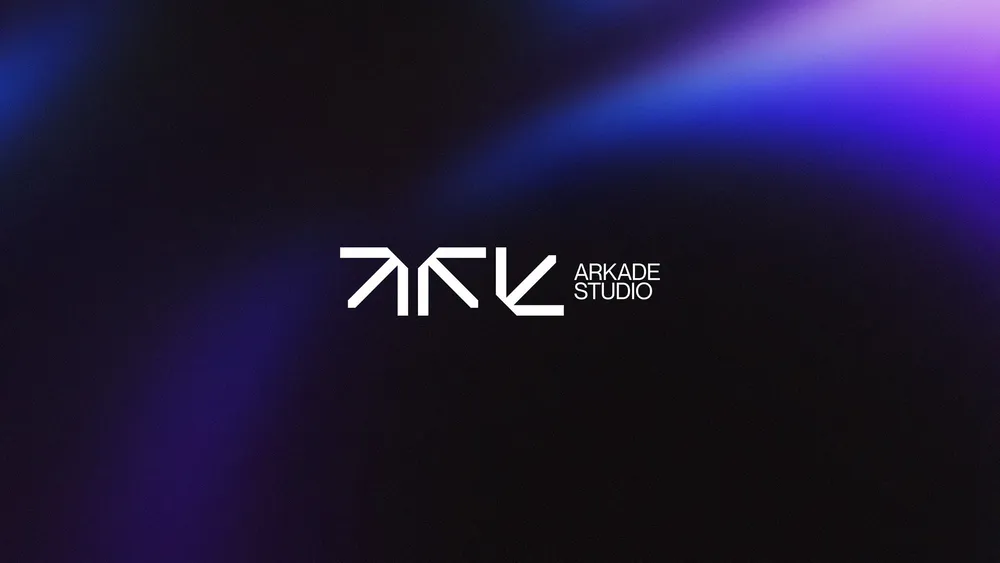

# White interlocking arrow monogram with stacked studio name over blurred violet light on black

**Discipline:** branding · **Design type:** Logo with symbol
**Tags:** logo, monogram, arrows, white, violet, blur, dark, studio

## What it is
A black field with blurred blue and violet light at the top and a white symbol of angular arrow shapes forming ARK, beside a stacked 'ARKADE STUDIO' wordmark in small caps.

## What it means
Sharp and technical; the angular monogram feels like a circuit or arrow set.

## Techniques
- Build letters from angular arrow shapes.
- Set a small stacked wordmark beside.
- Place on black with blurred colour.
- Use only white for the mark.

## Best for
- Studios and tech brands
- Angular monograms
- Dark cover slides

## Vocabulary
- **Arrow letters** — Letterforms made from arrow shapes.
- **Stacked name** — A name on two lines.
- **Blurred light** — Out-of-focus coloured glow.
- **White-on-black mark** — A logo reversed on dark.
