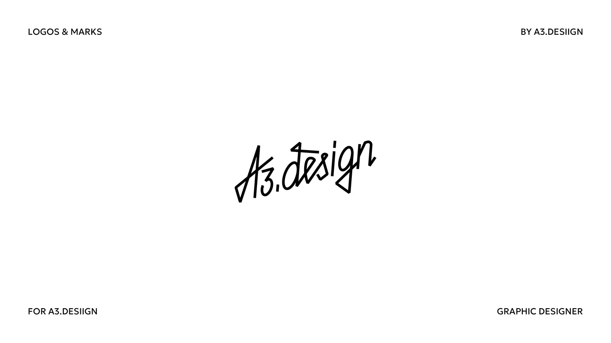

# Angular handwritten monoline logotype for a designer

**Discipline:** branding · **Design type:** Wordmarks
**Tags:** logotype, handwritten, monoline, black-and-white, signature, minimal, designer

## What it is
A white slide with a black monoline signature-style 'A3.design' drawn in sharp angular strokes with triangular loops, tilted upward. Four small caps labels frame the corners.

## What it means
Personal and expressive, like an autograph; angular strokes add a modern edge.

## Techniques
- Draw a wordmark as a single-weight handwritten line with angular joins.
- Tilt the whole mark upward for energy.
- Use triangles for descender and ascender loops.
- Keep everything else tiny and static so the signature dominates.

## Best for
- Personal brands and freelancers
- Creative studios
- Signature-style logos for stamps and packaging

## Vocabulary
- **Signature logotype** — A wordmark that looks like a handwritten signature.
- **Monoline script** — Handwriting drawn with uniform stroke width.
- **Angular joins** — Sharp corners in a script.
- **Upward tilt** — Rotating a mark to imply momentum.
