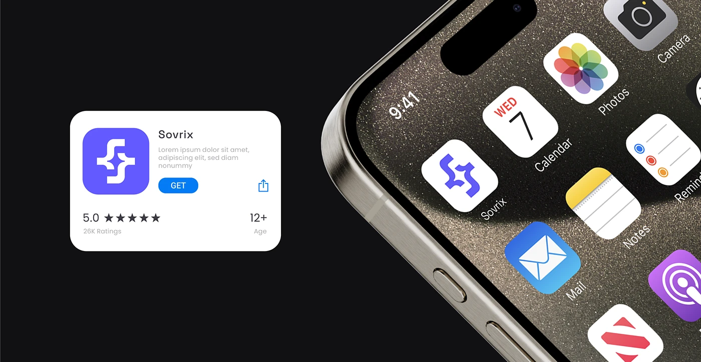

# App Store listing card for Sovrix beside a close-up of a titanium iPhone home screen with the white-tile icon

**Discipline:** branding ·  · **Design style:** Geometric & Bauhaus
**Tags:** app-icon, store-card, home-screen, black, violet, titanium, close-up, application

## What it is
A black field with a white App Store-style card at left showing the violet icon, name, description, a blue GET button, a 5.0 rating and age, and at right a large close-up of a titanium phone corner with the home screen where a white tile with a violet symbol sits among Photos, Calendar, Notes, Mail and Podcasts.

## What it means
Precise and tangible; seeing the icon among real apps proves its fit.

## Techniques
- Place the icon among native apps.
- Show the listing card next to it.
- Crop the phone tightly.
- Stage on black.

## Best for
- App icon presentations
- Store listing mockups
- Dark application boards

## Vocabulary
- **Icon among natives** — An icon shown with real system apps.
- **Store listing card** — An app store tile with name, rating and GET.
- **Titanium frame** — A brushed metal phone edge.
- **Close-up crop** — A tight view of a detail.
