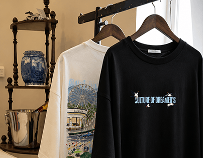

# Two tees on wooden hangers in a warm antique interior

**Discipline:** branding · **Design type:** Apparel and merch
**Tags:** apparel, t-shirt, mockup, editorial, antique-interior, black-and-cream, graphic-print

## What it is
A photo of two t-shirts on hangers: a cream tee with an illustrated Ferris wheel scene and a black tee with a small pixel-star wordmark 'Culture of dreamer's', beside a blue-and-white vase on a wood shelf.

## What it means
Curated, lived-in and youthful; the vintage setting makes streetwear feel collectible.

## Techniques
- Show merchandise in a styled interior instead of a flat studio shot.
- Vary graphics between a detailed illustration and a tiny wordmark.
- Match the set's warm neutrals with the tees.
- Use natural light and depth of field for a lifestyle feel.

## Best for
- Clothing brand launches
- Merch presentations
- Lifestyle brand imagery

## Vocabulary
- **Lifestyle mockup** — Product shown in a realistic scene.
- **Chest print** — A small graphic on the front of a shirt.
- **Set dressing** — Props chosen to support the mood.
- **Colourway** — A colour variation of a garment.
