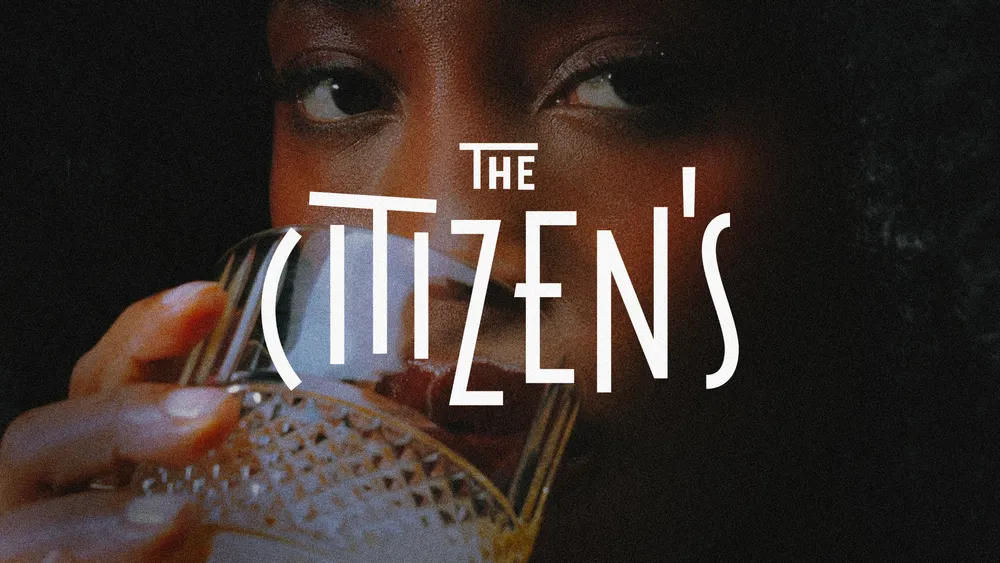

# Art Deco Wordmark over Cinematic Portrait

**Discipline:** branding · **Design type:** Wordmarks
**Tags:** art-deco, wordmark, cinematic, dark, bar, condensed, film-grain

## What it is
A white condensed Art Deco style wordmark, 'THE CITIZEN'S', with tall thin letters, a small 'THE' above and playful shifted letterforms, laid across a grainy close-up of a face sipping a drink from a cut-crystal glass.

## What it means
The tall geometric letters evoke 1920s glamour while the dark grainy photograph adds intimacy and late-night mystery, promising a moody, upscale bar.

## Techniques
- Tall condensed geometric caps with unexpected stroke terminals
- Break the baseline slightly for personality and rhythm
- White logo on very dark photo for maximum contrast
- Crop the face at the eyes and glass so the type sits over the subject deliberately
- Film grain and warm skin tones for tactile atmosphere

## Best for
- Bars, restaurants and hospitality brands
- Vintage-inspired identities
- Film, music and nightlife promotion

## Vocabulary
- **Art Deco lettering** — Geometric, high-contrast, often tall and condensed letterforms inspired by 1920s design.
- **Film grain** — Visible noise texture that gives an image an analog feel.
- **Logo over photo** — A wordmark placed directly on a photograph rather than on a flat field.
