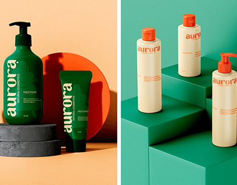

# Aurora natural cosmetics: green bottles on peach plinths and cream bottles on green steps

**Discipline:** branding · **Design type:** Packaging photography · **Design style:** 3D & Surreal
**Tags:** cosmetics, packaging, green, orange, 3d-render, plinths

## What it is
A split image: left, a dark green pump bottle and tube with vertical orange 'aurora' wordmarks on grey plinths against peach with an orange disc; right, three cream bottles with orange caps on stepped green blocks.

## What it means
Fresh and bold; swapping bottle and background colours shows a flexible two-colour system.

## Techniques
- Invert the palette between product and set.
- Stage bottles on steps and plinths for rhythm.
- Run a lowercase wordmark vertically up the bottle.

## Best for
- Cosmetics brands
- Packaging showcases
- Two-colour identities

## Vocabulary
- **Plinth** — A block or pedestal used to display a product.
- **Colour inversion** — Swapping foreground and background colours.
