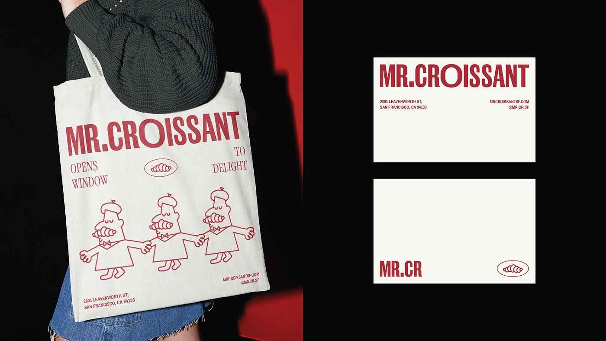

# Red-and-cream bakery identity with condensed wordmark and line-drawn croissant mascots

**Discipline:** branding ·  · **Design style:** Neo-Brutalist
**Tags:** bakery, red, cream, condensed-type, mascot, line-drawing, tote-bag, business-cards

## What it is
A split image: left, a model carrying a cream tote printed in red with tall condensed 'MR.CROISSANT', a croissant badge and three line-drawn beret-wearing figures holding hands, on a black and red backdrop; right, two cream cards on black with the same wordmark and small addresses.

## What it means
Charming, witty and Parisian; a limited red on cream keeps it simple and confident.

## Techniques
- Combine a condensed sans wordmark with a light serif for the secondary text.
- Draw mascots in one line weight with a red stroke.
- Use only one ink colour on cream stock.
- Stage the mockup on a dark background so the cream pops.

## Best for
- Bakeries, cafés and food retail
- One-colour print identities
- Characterful mascots

## Vocabulary
- **One-ink identity** — A brand printed in a single colour.
- **Line mascot** — A character drawn with a single-weight outline.
- **Condensed wordmark** — A narrow tall sans logo.
- **Oval badge** — A small oval containing a symbol.
