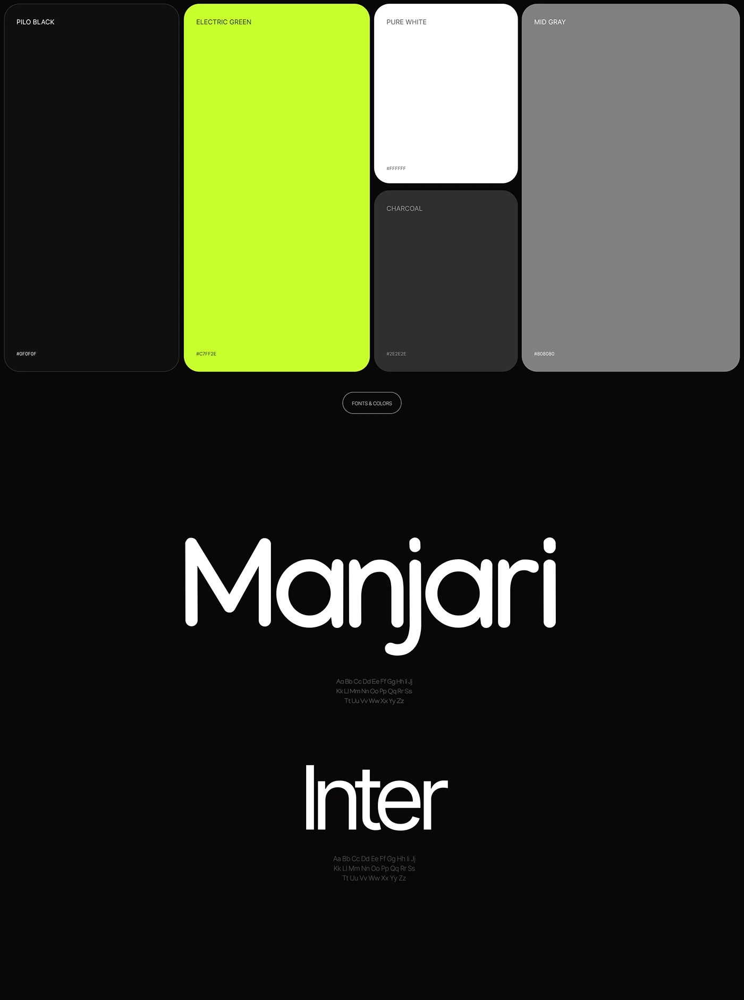

# Tall colour cards in black, electric green, white, charcoal, grey over giant Manjari and Inter specimens

**Discipline:** branding · **Design type:** Typography and colour guide
**Tags:** colour-palette, typography, black, electric-green, rounded-cards, rounded-sans, specimen, guidelines

## What it is
A black board with a top row of tall rounded colour cards (Pilo Black, Electric Green, Pure White, Charcoal, Mid Gray with hex codes), an outlined 'Fonts & Colors' pill, and two giant white type specimens, rounded Manjari and tight Inter, each with a small alphabet.

## What it means
Bold and modern; big cards and giant type make the system feel confident.

## Techniques
- Show colours as tall rounded cards of varied size.
- Present giant specimens on black.
- Use small alphabets under specimens.
- Keep labels tiny.

## Best for
- Brand guidelines
- Dark presentations of type and colour
- Neon-green identities

## Vocabulary
- **Tall swatch card** — A tall rounded rectangle showing a colour.
- **Type pair** — A display face and a text face.
- **Hex label** — A small code inside a swatch.
- **Section pill** — An outlined capsule naming a section.
