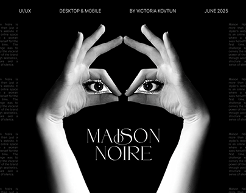

# Black-and-white hands forming a frame around eyes, with a serif 'Maison Noire' title

**Discipline:** branding · **Design type:** Brand presentation cover
**Tags:** luxury, black-and-white, hands, eyes, serif, cover, ui-ux, editorial

## What it is
A black cover with a greyscale photo of two hands forming a triangular frame each with an eye in the palm, a flourished serif title 'MAISON NOIRE' in the middle and tiny credits and columns of text at the sides.

## What it means
Mysterious and elegant; the eye-in-hand image sets a fashion-noir tone.

## Techniques
- Use a surreal black-and-white photo as the central image.
- Set a flourished serif title.
- Place tiny credits in the corners.
- Add faint text columns at the sides.

## Best for
- Luxury and fashion presentations
- Serif noir identities
- Cover slides with a striking image

## Vocabulary
- **Surreal monochrome** — A dreamlike black-and-white image.
- **Flourished serif** — A serif with decorative swashes.
- **Side columns** — Faint text running down the edges.
- **Noir palette** — Black, white and grey only.
