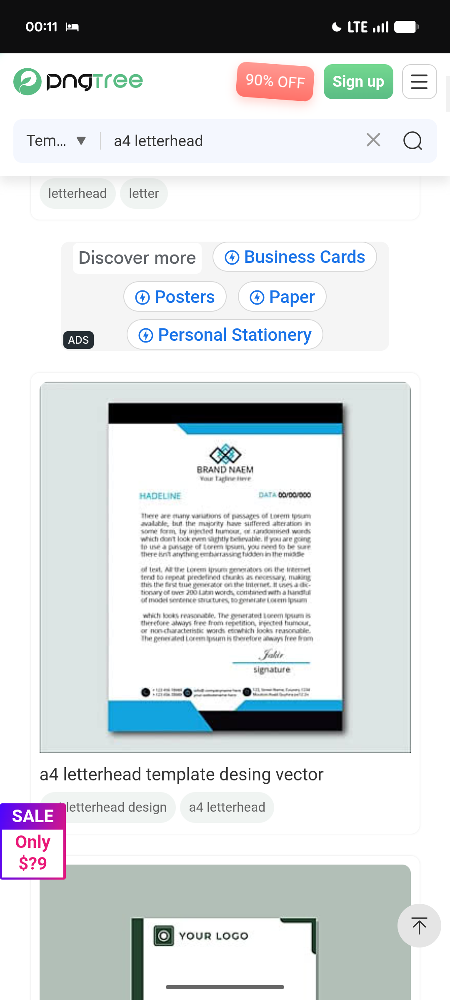

# Black Band and Cyan Slash Letterhead

**Discipline:** branding · **Design type:** Packaging and print collateral
**Tags:** letterhead, stationery, black, cyan, template, diamond-logo, print

## What it is
A stock-template screenshot of an A4 letterhead with a black top band cut by a cyan diagonal, a centred interlocking-diamond logo, a headline and date row, justified body text, a signature line and a footer with three contact circles above a black band with a cyan wedge.

## What it means
Mirrored top and bottom corner shapes frame the page symmetrically, and one cyan accent on black feels crisp and corporate.

## Techniques
- Matching diagonal corner shapes at top and bottom
- Centred logo with the tagline beneath
- Headline left and date right on one row
- Contact details as three icon columns
- Single cyan accent against black

## Best for
- Corporate letterheads
- Stationery templates
- Print identity references

## Vocabulary
- **Corner mirror** — Matching shapes placed at opposite corners to balance a page.
- **Contact row** — Address, phone and email arranged in equal columns.
- **Letterhead template** — A page layout with placeholder branding and text.
