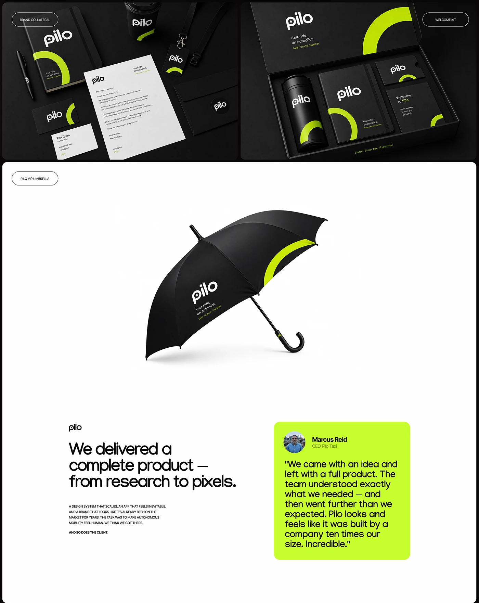

# Black stationery flat lay, welcome-kit box and umbrella with an electric lime arc and 'pilo' logo, plus testimonial

**Discipline:** branding · **Design type:** Packaging and print collateral
**Tags:** collateral, stationery, black, electric-lime, welcome-kit, umbrella, arc, testimonial

## What it is
A board with a black flat lay (notebook, pen, lanyard, letter, envelope, cards, cup) and a welcome kit box (thermos, notebook, card, letter) all printed with a lime arc and white 'pilo' wordmark, a white panel with a black umbrella with a lime arc, and a text block with a lime testimonial card from a CEO.

## What it means
Sleek and confident; one lime arc turns black objects into a system.

## Techniques
- Use a single lime arc as the brand graphic.
- Keep all items black with white type.
- Present a kit box and a hero object.
- End with a lime testimonial card.

## Best for
- Brand collateral and welcome kits
- Black and lime identities
- Merch systems

## Vocabulary
- **Brand arc** — A recurring curved shape used on items.
- **Welcome kit** — A branded box of onboarding items.
- **Flat lay** — Items photographed from above.
- **Testimonial card** — A coloured card with a client quote.
