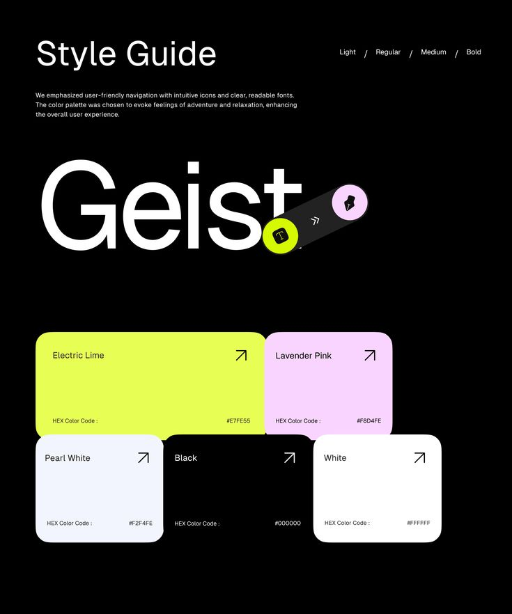

# Geist Style Guide with Lime and Lavender

**Discipline:** branding ·  · **Design style:** Dark & Neon
**Tags:** style-guide, black, lime, lavender, geist, palette, cards, icons

## What it is
A black style guide page with a 'Style Guide' title and weights list, a giant white 'Geist' specimen crossed by a pill with tool icons, and interlocking rounded colour cards for Electric Lime, Lavender Pink, Pearl White, Black and White with hex codes.

## What it means
Interlocking cards make the palette feel like puzzle pieces, and neon lime with lavender feels fresh and playful on black.

## Techniques
- Giant specimen overlapped by a pill of icons
- Colour cards notched into each other
- Arrow icons in each card corner
- Names and hex codes at the card edges
- Neon lime as the lead colour

## Best for
- Dark style guide pages
- Playful tech identities
- Type and colour combined slides

## Vocabulary
- **Interlocking cards** — Rounded cards notched into one another like puzzle pieces.
- **Icon pill** — A capsule holding a few tool icons.
- **Style guide** — A page documenting type, colour and usage.
