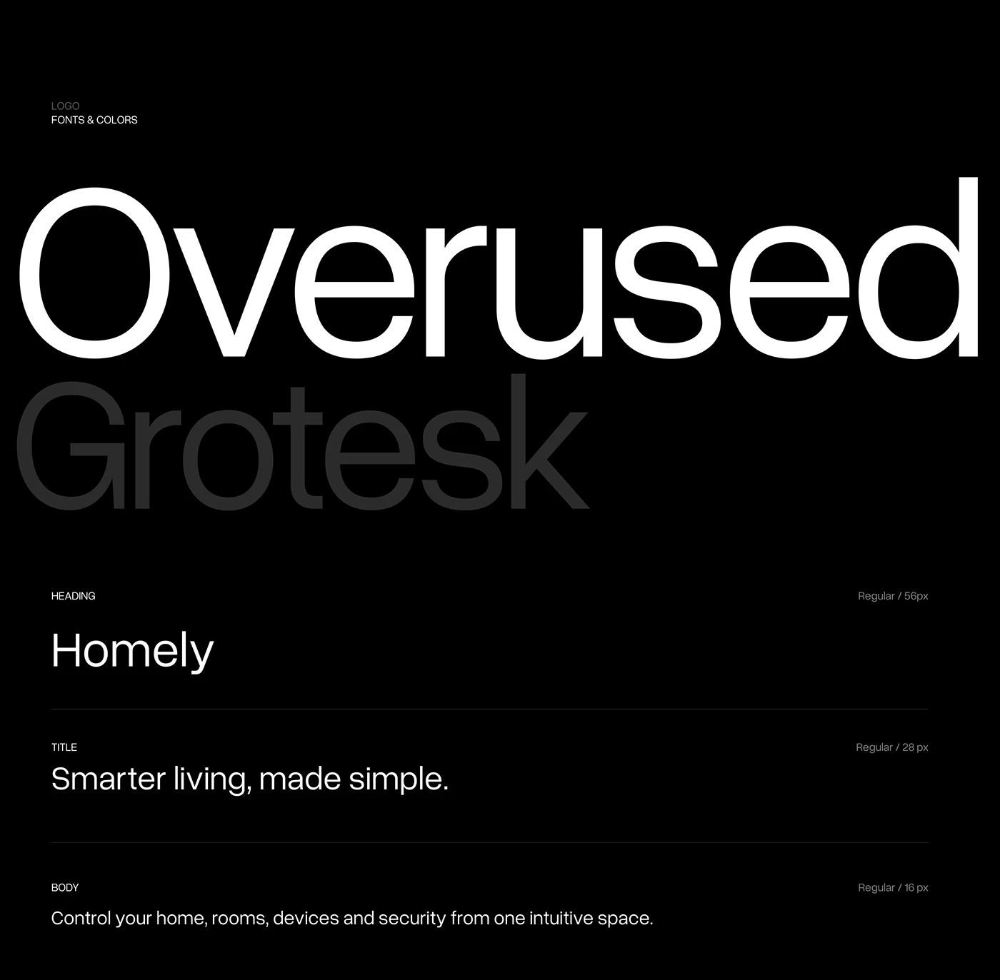

# Overused Grotesk Type Specimen on Black

**Discipline:** branding ·  · **Design style:** Dark & Neon
**Tags:** typography, black, grotesk, specimen, fade, scale, white

## What it is
A black page with a giant white 'Overused' above a dark grey 'Grotesk' fading away, then rows for heading, title and body samples with labels and sizes separated by hairlines.

## What it means
The huge specimen makes the typeface the hero, and the fading second word adds depth.

## Techniques
- Giant specimen filling the width
- Second line at very low contrast
- Hairline-separated sample rows
- Small caps role labels with right-aligned sizes
- Only white and grey on black

## Best for
- Typography documentation
- Dark brand guidelines
- Type specimens

## Vocabulary
- **Specimen** — A large display of a typeface.
- **Role label** — A small caption naming a text role like heading or body.
- **Fade line** — A line set at very low contrast to recede.
