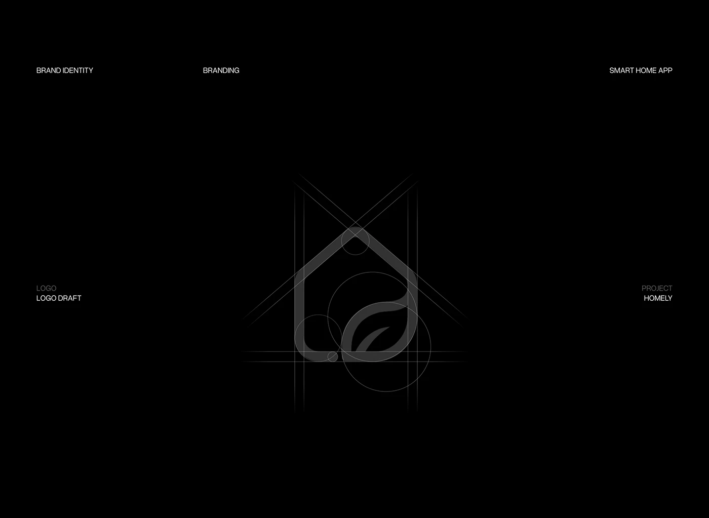

# House and Leaf Logo Construction

**Discipline:** branding ·  · **Design style:** Dark & Neon
**Tags:** logo, construction, grid, circles, black, house, leaf, monoline

## What it is
A black page showing the house-and-leaf logo in dark grey with its construction geometry: circles, diagonals and vertical guides, framed by small labels for brand identity, logo draft and project.

## What it means
Revealing the geometry shows rigour and craft, and the near-invisible grey on black feels like a technical drawing.

## Techniques
- Construction circles and diagonal guides drawn over the mark
- Low-contrast grey lines on black
- Four corner labels framing the mark
- Symmetry and tangent circles explaining curves
- Extremely sparse composition

## Best for
- Logo design process slides
- Identity documentation
- Geometric mark explanations

## Vocabulary
- **Construction grid** — Circles and lines that show how a logo was built.
- **Tangent circles** — Circles touching at a single point to define curves.
- **Draft view** — A presentation of a logo in its construction stage.
