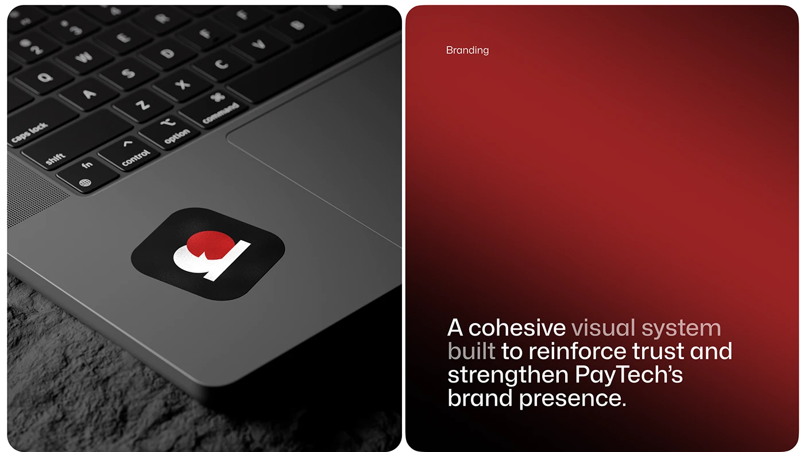

# Trackpad Sticker and Red Brand Statement

**Discipline:** branding · **Design type:** Brand application mockups
**Tags:** sticker, laptop, logo, red, gradient, statement, dark

## What it is
A split image: a black app-icon sticker with a red and white monogram stuck on a laptop trackpad above a rough stone surface, and a red-to-black gradient panel labelled Branding with a statement about a cohesive visual system building trust.

## What it means
A small sticker on a real object proves the mark works small, and the red panel sets the brand tone.

## Techniques
- Logo sticker on a laptop
- Macro shot with shallow depth
- Red gradient statement panel
- Dimmed words in the statement
- Two equal rounded panels

## Best for
- Brand application mockups
- Sticker and merch showcases
- Fintech brand presentations

## Vocabulary
- **Sticker mockup** — A logo shown as an adhesive sticker on an object.
- **Macro shot** — A close-up photograph of a small object.
- **Statement panel** — A panel holding one sentence describing the brand.
