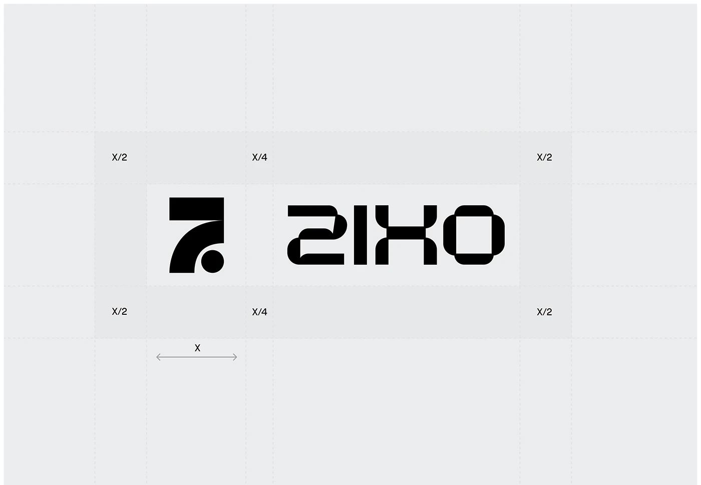

# Logo Clear Space and Spacing Grid

**Discipline:** branding · **Design type:** Logo guidelines
**Tags:** logo, clear-space, grid, black, monogram, wordmark, guidelines

## What it is
A light grey page with a dashed grid showing a black stepped monogram with a dot and a blocky wordmark, surrounded by clear-space measurements marked X, X/2 and X/4 and an X width arrow.

## What it means
Showing the spacing rules makes the logo feel systematic and protects it in use.

## Techniques
- Dashed grid lines behind the logo
- Clear space defined by fractions of the mark width
- Shaded margin zones around the lockup
- Simple black logo on light grey
- Measurement arrow beneath the mark

## Best for
- Logo usage guidelines
- Brand manuals
- Wordmark and symbol lockups

## Vocabulary
- **Clear space** — The empty margin required around a logo.
- **X-unit** — A measurement derived from part of the logo used to define spacing.
- **Lockup** — A fixed arrangement of symbol and wordmark.
