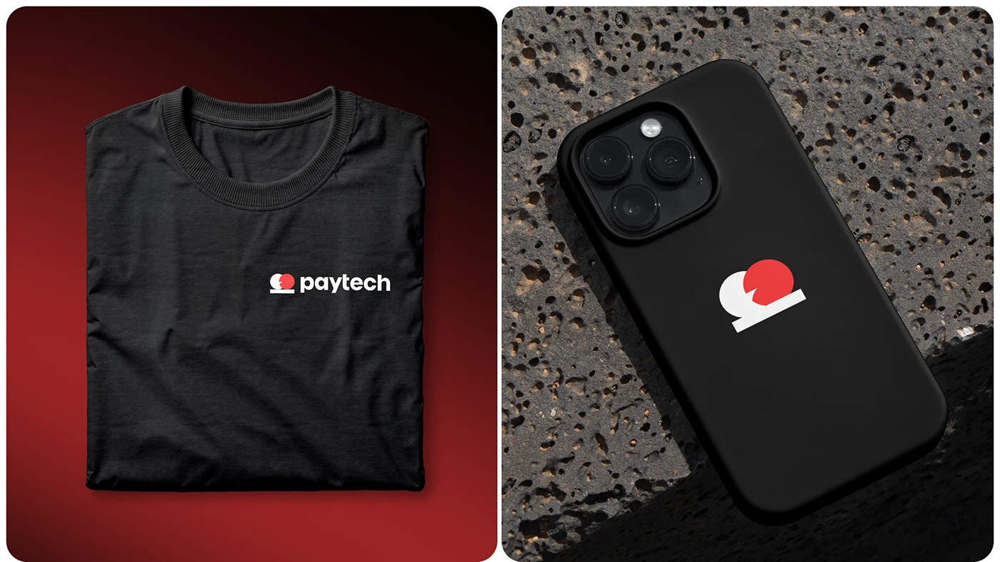

# Black Tee and Phone Case with Red Mark

**Discipline:** branding · **Design type:** Apparel and merch
**Tags:** merch, t-shirt, phone-case, red, black, logo, stone

## What it is
A split image: a folded black t-shirt with a small white 'paytech' logo on a red vignette, and a black phone case with a large red and white mark lying on rough volcanic stone.

## What it means
Small chest print and a big case mark show the logo at two scales on simple black objects, and the red is a strong accent.

## Techniques
- Small logo on a chest versus a large mark on a case
- Black objects on red and stone backgrounds
- Top-down flat lay of folded apparel
- Rough texture behind smooth product
- Two equal rounded panels

## Best for
- Merch and apparel mockups
- Brand mark scale demonstrations
- Dark red brand systems

## Vocabulary
- **Flat lay** — A product photographed from above on a surface.
- **Chest print** — A small logo placed on the upper chest of a garment.
- **Scale contrast** — Showing a mark small and large.
