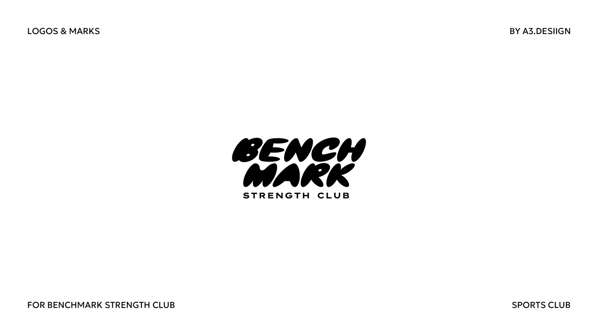

# Puffy bold-italic BENCH MARK wordmark with a wide-tracked subline

**Discipline:** branding ·  · **Design style:** Editorial
**Tags:** wordmark, bubble-type, italic, black-and-white, gym, stacked, corner-labels, strength

## What it is
A white slide with tiny caps corner labels and a black stacked wordmark 'BENCH MARK' in fat slanted rounded letters with small counters, above 'STRENGTH CLUB' in wide tracked caps.

## What it means
Heavy, friendly and energetic; the puffy italics feel like lifted weight.

## Techniques
- Use inflated slanted letters with tiny counters.
- Stack a two-word name tightly.
- Contrast with a wide-tracked caps descriptor.
- Keep black on white.

## Best for
- Gyms and sports clubs
- Playful heavy-weight wordmarks
- Streetwear-adjacent brands

## Vocabulary
- **Inflated type** — Letters that look puffed with air.
- **Tight stack** — Lines set with almost no leading.
- **Tracked descriptor** — Widely spaced small caps under a logo.
- **Slanted heavy** — A very bold italic style.
