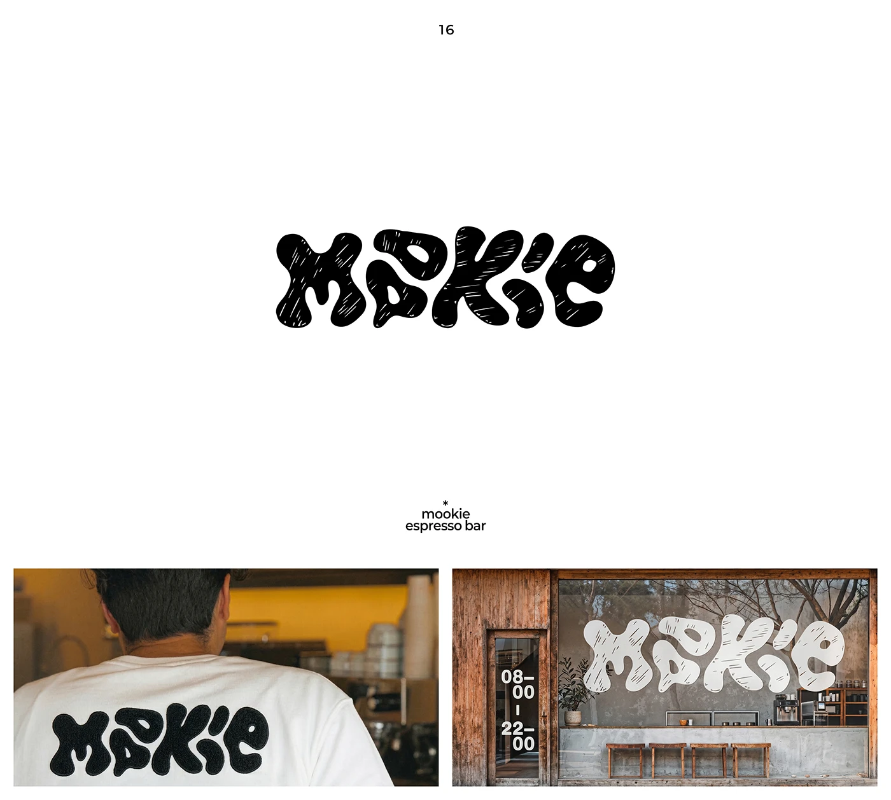

# Melting black MOOKIE wordmark with hatched scratches, as chenille tee patch and a giant white window decal on a cafe

**Discipline:** branding · **Design type:** Wordmarks
**Tags:** wordmark, blob-type, scratchy, black-and-white, espresso-bar, chenille, window, hospitality

## What it is
A white slide with a fat, melting wordmark 'mookie' filled with fine white hatching, a caption 'mookie espresso bar' and two photos: a person in a white tee with a fuzzy black chenille version on the back and a wooden cafe facade with a giant white decal in the window and the hours '08–00 | 22–00' on the door.

## What it means
Cosy and mischievous; blobby scribbly letters feel like a friendly neighbourhood coffee spot.

## Techniques
- Melt letters into rounded blobs.
- Add scratchy hatching texture.
- Stitch it as a chenille patch.
- Use it huge on the window in white.

## Best for
- Cafés and espresso bars
- Blob wordmarks
- Merch and window decals

## Vocabulary
- **Blob lettering** — Letters with soft melted shapes.
- **Hatched texture** — Fine scratch lines inside a shape.
- **Chenille patch** — A fuzzy stitched embroidery.
- **Window decal** — A vinyl graphic applied to glass.
