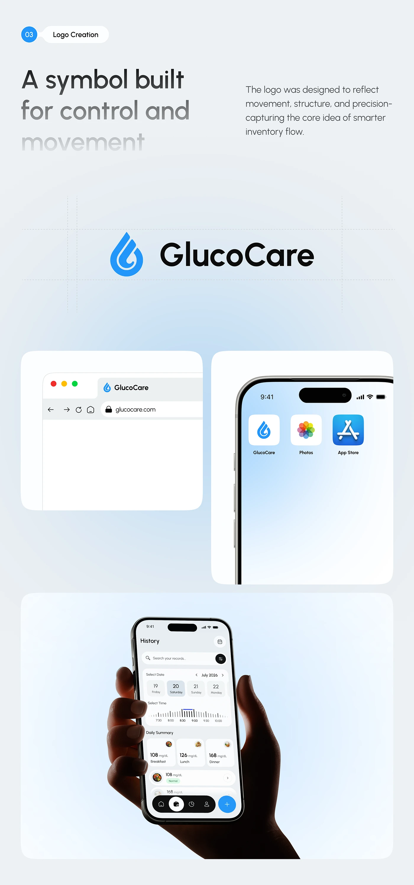

# Blue Droplet Logo and Applications

**Discipline:** branding ·  · **Design style:** Gradient & Aurora
**Tags:** logo, droplet, blue, browser-tab, app-icon, health, tall

## What it is
A tall pale blue sheet with a step tag 'Logo Creation', a gradient headline about a symbol for control and movement, the blue droplet mark with wordmark 'GlucoCare' on guide lines, then browser-tab, home-screen icon and in-hand app mockups.

## What it means
A single blue droplet with a swirl feels medical yet friendly, and showing tab and icon proves it works small.

## Techniques
- Droplet symbol with an internal swirl for movement
- Guide lines framing the logo lock-up
- Fading headline lines to focus attention
- Browser tab and iOS icon as scale tests
- Soft blue radial gradients

## Best for
- Health-tech identities
- Logo presentation pages
- Symbol-led wordmark lockups

## Vocabulary
- **Symbol and wordmark lockup** — A logo combining an icon and a name in a fixed arrangement.
- **Scale test** — Showing a logo at favicon and app icon sizes.
- **Fading headline** — A headline whose lines lose contrast progressively.
