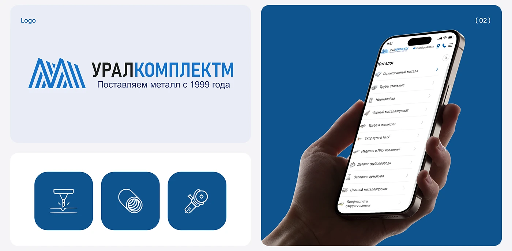

# Blue metal-supplier logo, three line icons and a hand holding the catalogue

**Discipline:** branding · **Design type:** Brand identity presentation
**Tags:** industrial, blue, logo, line-icons, rounded-tiles, catalog, phone-in-hand, cyrillic

## What it is
A pale board with a large logo card (striped blue monogram, black and blue split wordmark, tagline), three dark-blue rounded tiles with white line icons for laser cutting, pipe and grinder, and a blue panel showing a hand holding a phone with a category list.

## What it means
Reliable and practical; simple line icons make technical services understandable.

## Techniques
- Show the logo, icon set and application in a tidy tile grid.
- Draw service icons in white line on deep blue rounded squares.
- Present the mobile catalogue held in a hand on a solid blue field.
- Split a wordmark into black and blue parts.

## Best for
- B2B and industrial identities
- Icon set presentations
- Catalogue-based brands

## Vocabulary
- **Split wordmark** — A name coloured in two parts.
- **Line icon tile** — A pictogram on a rounded square.
- **Tile board** — A presentation of rounded tiles.
- **Application panel** — A tile showing the brand in use.
