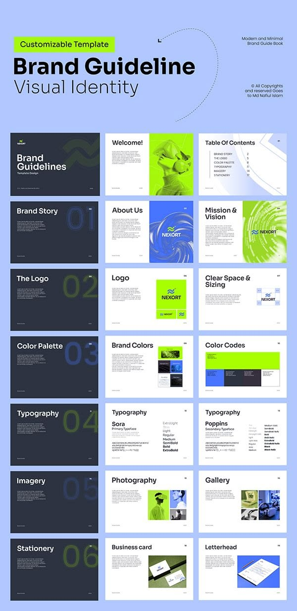

# Blue and Lime Brand Guideline Template

**Discipline:** branding · **Design type:** Brand guidelines deck
**Tags:** brand-guidelines, template, lime, cperiwinkle, slides, overview, modern

## What it is
A periwinkle sheet with a big 'Brand Guideline / Visual Identity' title and a 3-by-7 grid of slide thumbnails: navy section dividers with ghost numerals, and white pages for logo, colour, typography, imagery and stationery.

## What it means
Showing every slide type in one overview sells a template's completeness, while lime and blue keep it energetic.

## Techniques
- Dark divider slides with big ghost numerals between content sections
- Lime tag label for the 'Customizable Template' claim
- Grid of uniform slide thumbnails
- 3D chrome-blob imagery as a modern accent
- Consistent lime and cobalt colour pairing

## Best for
- Brand guideline templates
- Identity documentation
- Marketplace template listings

## Vocabulary
- **Section divider** — A slide that introduces a new part of a document.
- **Template overview** — A sheet showing all pages of a template at small scale.
- **Ghost numeral** — An oversized faint number used as a decorative marker.
