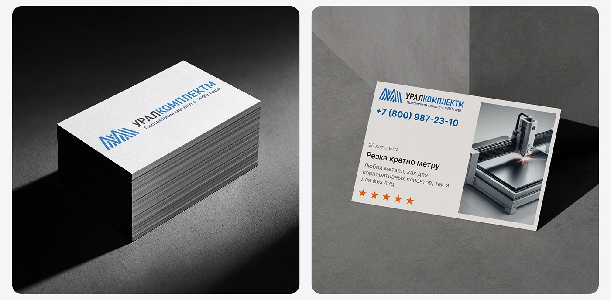

# White business cards with a blue striped-M logo, shown as a stack in hard light and standing with a laser-cutting photo

**Discipline:** branding · **Design type:** Brand application mockups
**Tags:** business-cards, blue, white, industrial, grey, hard-light, stack, cyrillic

## What it is
Two rounded panels: a black-to-grey scene with a thick stack of white cards printed with a blue striped monogram and a two-tone name, and a grey concrete corner with a card standing that includes phone, '20 years of experience', a service title, orange stars and a photo of a laser cutter.

## What it means
Reliable and precise; a striped monogram and a machine photo signal metalwork.

## Techniques
- Stack cards under hard light.
- Use a service photo inside the card.
- Add orange stars as trust.
- Keep the colour to blue with one orange.

## Best for
- Industrial B2B stationery
- Business card mockups
- Blue-white identities

## Vocabulary
- **Card stack** — Business cards piled to show thickness.
- **Service card** — A card featuring a service photo and claim.
- **Hard light** — Direct light casting strong shadows.
- **Trust stars** — Rating stars on a card.
