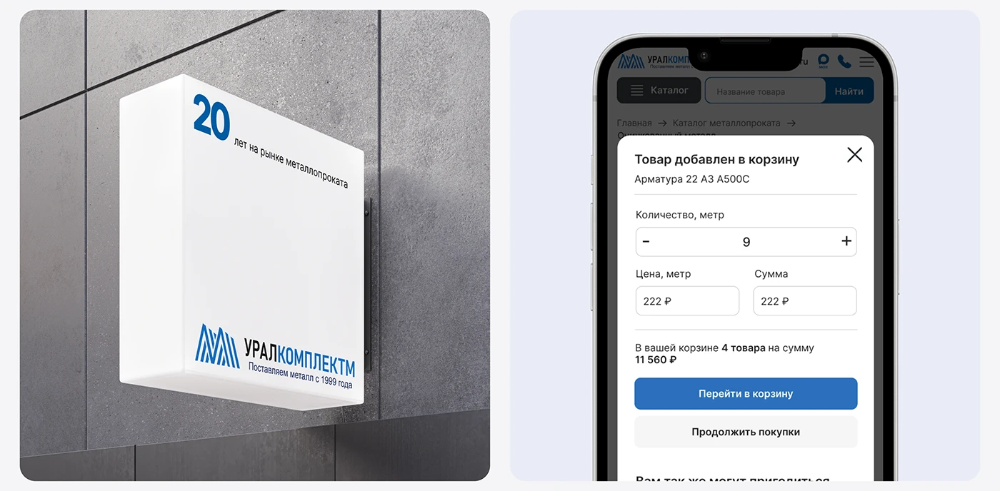

# Light-box wall sign and mobile add-to-cart modal in blue and white

**Discipline:** branding · **Design type:** Brand application mockups
**Tags:** signage, light-box, blue, modal, mobile, industrial, concrete, cyrillic

## What it is
Two panels: a white light-box on grey concrete with a large blue '20' and the striped-monogram logo, and a phone screen with a white modal titled with a quantity stepper, price fields, cart summary and a blue Go-to-cart button.

## What it means
Straightforward and dependable; a physical sign and a clear modal show the same trustworthy brand.

## Techniques
- Pair physical signage with a digital component.
- Use a big blue numeral as an anniversary graphic.
- Design the modal with grouped inputs and one blue action.
- Place the sign on raw concrete.

## Best for
- Industrial and B2B identities
- Cross-channel application boards
- Anniversary branding

## Vocabulary
- **Light-box sign** — An illuminated box sign mounted to a wall.
- **Anniversary numeral** — A large number marking years in business.
- **Modal sheet** — A panel over a dimmed screen for a task.
- **Cross-channel** — Applications in both physical and digital forms.
