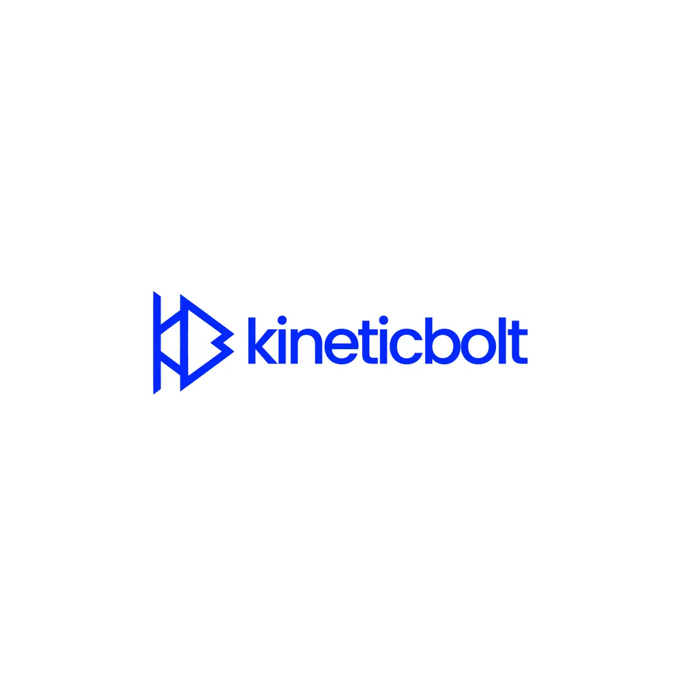

# Electric blue monoline symbol combining a play triangle and a K/B with a lowercase 'kineticbolt' wordmark

**Discipline:** branding ·  · **Design style:** Geometric & Bauhaus
**Tags:** logo, symbol, monoline, electric-blue, play-triangle, lowercase, white-background, tech

## What it is
A white square with an electric blue logo: a thin-line symbol where vertical bars, a triangle and a rounded notch form a K and B and a play button, beside a lowercase geometric sans 'kineticbolt'.

## What it means
Energetic and precise; the play triangle and bolt suggest motion and media.

## Techniques
- Combine letters and a play button in one monoline symbol.
- Pair with a lowercase geometric sans.
- Use a single electric blue.
- Keep generous space.

## Best for
- Video, media and tech brands
- Monoline symbols
- Single-colour lockups

## Vocabulary
- **Play symbol** — A triangle indicating video playback.
- **Letter combination** — Two initials merged into one mark.
- **Electric blue** — A vivid saturated blue.
- **Horizontal lockup** — Symbol and name side by side.
