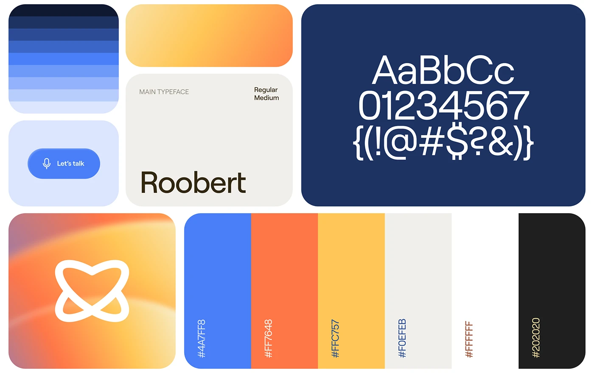

# Bento brand board: blue ramp, warm gradient, type specimen, hex stripes and orbit icon

**Discipline:** branding · **Design type:** Typography and colour guide
**Tags:** brand-board, bento, blue, orange, yellow, typography, gradient, icon, hex-codes

## What it is
A white grid of rounded tiles: a stepped blue ramp, an orange-yellow gradient, a Let's talk button, a cream typeface card with 'Roobert', a navy specimen tile with AaBbCc and numerals, an orange gradient tile with a white orbit-heart icon, and vertical colour bars with hex codes.

## What it means
Friendly and optimistic; cool blue with sunny gradients feels warm and approachable.

## Techniques
- Arrange all identity parts as a bento of rounded tiles.
- Show colour as ramps, gradients and labelled bars together.
- Render type as a giant specimen on a dark tile.
- Use a gradient tile for the icon.

## Best for
- Brand guideline overviews
- AI and consumer app identities
- Single-sheet brand summaries

## Vocabulary
- **Bento brand board** — A modular grid summarising a brand.
- **Colour ramp** — A stepped series of tones of one hue.
- **Gradient tile** — A tile filled with a colour blend.
- **Hex bar** — A vertical swatch labelled with its code.
