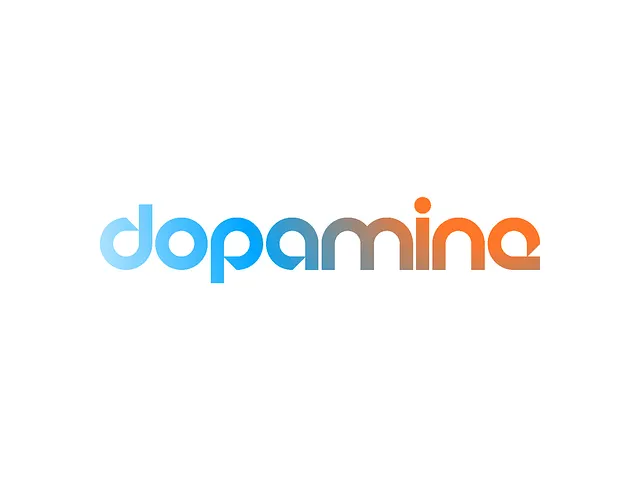

# Geometric lowercase wordmark fading from sky blue to orange

**Discipline:** branding ·  · **Design style:** Geometric & Bauhaus
**Tags:** wordmark, gradient, lowercase, rounded, blue, orange, geometric, white-background

## What it is
A white slide with 'dopamine' in lowercase rounded geometric letters with cut-out details, coloured by a smooth gradient from pale blue on the left through grey to orange on the right, with the i's dot in orange.

## What it means
Bright and energetic; the colour shift hints at mood or reward.

## Techniques
- Apply a single left-to-right gradient across a wordmark.
- Use geometric letters with small cuts for character.
- Make the tittle a solid dot in the end colour.
- Keep it on plain white.

## Best for
- Consumer apps and wellbeing brands
- Gradient wordmarks
- Digital-first logos

## Vocabulary
- **Gradient wordmark** — A logo filled with a colour blend.
- **Geometric sans** — Letterforms built from circles and lines.
- **Tittle** — The dot over an i or j.
- **Cool-to-warm shift** — A gradient from blue to orange.
