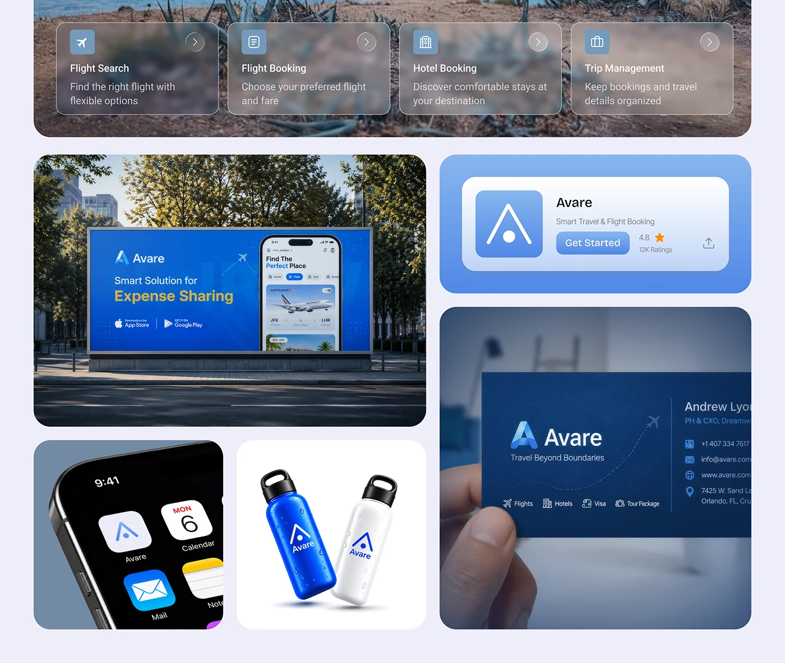

# Blue Travel Brand Application Tiles

**Discipline:** branding · **Design type:** Brand application mockups
**Tags:** blue, travel, billboard, business-card, bottle, app-icon, glass-cards

## What it is
A lavender board of rounded tiles: glass feature cards over a photo, a roadside billboard with an app phone, a store-listing card, a home-screen icon, blue and white bottles, and a business card held in a hand.

## What it means
Repeating one strong blue across billboard, bottles and cards builds instant recognition and a sense of scale.

## Techniques
- Mix of environment scenes and flat product shots
- Frosted glass cards over photography
- Same logo mark on merchandise and app icon
- Hand-held business card for a human touch
- Uniform corner radius across tiles

## Best for
- Travel and mobility brands
- Identity presentation boards
- Consumer app brand launches

## Vocabulary
- **Application tile** — A tile showing the brand on one real-world item.
- **Environment mockup** — A design shown inside a realistic location.
- **Frosted card** — A blurred translucent card over an image.
