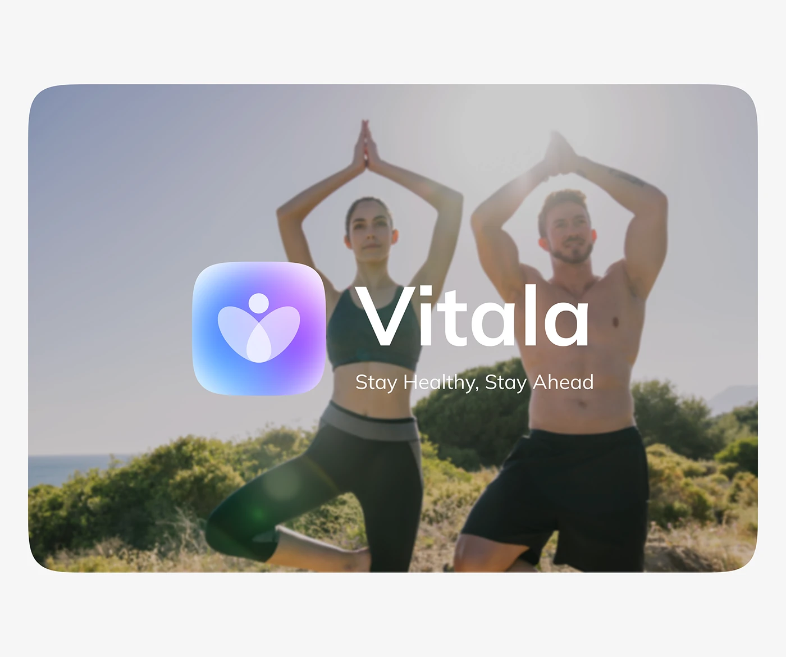

# Yoga Photo with Gradient App Icon Cover

**Discipline:** branding · **Design type:** Brand presentation cover
**Tags:** cover, icon, wordmark, yoga, blur, gradient, tagline

## What it is
A rounded panel showing a blurred photo of two people in a yoga tree pose with a large gradient app icon, white wordmark 'Vitala' and the tagline 'Stay Healthy, Stay Ahead' in the centre.

## What it means
The blurred lifestyle photo sets an active, healthy mood without competing with the logo.

## Techniques
- Heavily blurred photo as a backdrop
- Large icon and wordmark lock-up in white
- Glossy gradient icon for depth
- Tagline underneath in a lighter weight
- Rounded panel on a pale page

## Best for
- Wellness brand covers
- Brand reveal slides
- Lifestyle identity presentations

## Vocabulary
- **Blur backdrop** — A defocused photo used as a background.
- **Icon lockup** — An app icon placed beside the wordmark.
- **Tagline** — A short phrase summarising the brand promise.
