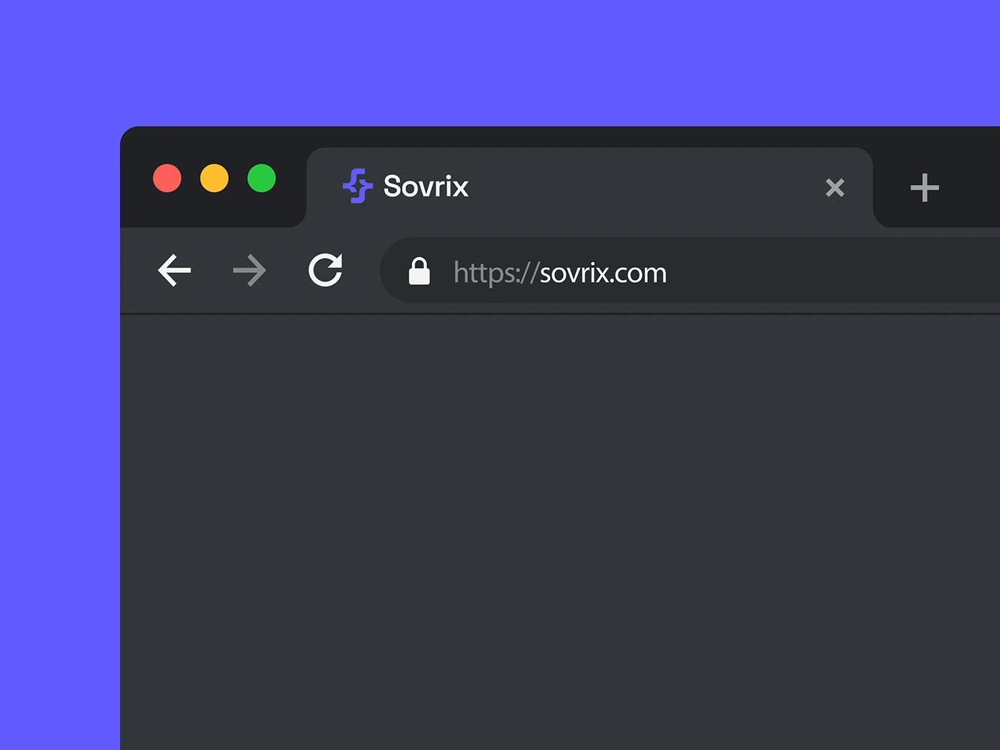

# Dark browser chrome with logo favicon cropped on a violet background

**Discipline:** branding ·  · **Design style:** Dark & Neon
**Tags:** favicon, browser, violet, dark-ui, logo-application, crop, url

## What it is
A dark browser window cropped at the top left on periwinkle violet, with traffic-light dots, a tab showing a violet monogram and 'Sovrix', a close button, back/forward/refresh icons and a URL 'https://sovrix.com'. The page area is blank grey.

## What it means
Precise and minimal; the crop makes the tiny logo the only story.

## Techniques
- Enlarge and crop browser chrome to focus on the favicon and tab.
- Use one saturated background colour matching the brand.
- Keep the window content empty so nothing distracts.
- Set the URL text in two greys.

## Best for
- Logo application slides
- Web brand presentations
- Showing digital touchpoints

## Vocabulary
- **Favicon** — A tiny logo shown in browser tabs.
- **Browser chrome** — The frame of a browser window.
- **Tight crop** — A close cut that enlarges a small detail.
- **Empty state frame** — A window with no content used as a stage.
